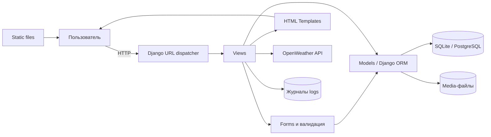

# SmartParking Solutions

## Назначение

SmartParking Solutions — веб-приложение для информационного сопровождения парковки и учёта клиентов, автомобилей, парковочных мест, начислений и платежей. Система предоставляет публичную информацию о компании и услугах, личный кабинет клиента, рабочую панель сотрудника и аналитическую панель администратора.

Система решает следующие задачи:

- централизует данные об автомобилях, владельцах и занятости парковочных мест;
- делает начисления, платежи и баланс доступными клиенту в личном кабинете;
- предоставляет сотрудникам средства оперативного учёта;
- предоставляет администратору отчётные показатели и управление стоимостью мест;
- публикует новости, услуги, промокоды, отзывы, вакансии и контактные сведения.

## Целевые пользователи

| Роль | Возможности |
|---|---|
| Посетитель | Просмотр публичных страниц, новостей, услуг, промокодов и отзывов; регистрация и вход |
| Клиент | Управление своими автомобилями, назначение свободного места, просмотр начислений и платежей, внесение платежа, публикация отзыва |
| Сотрудник | Просмотр всех автомобилей, управление автомобилями, создание начислений, просмотр платежей и загрузки парковки |
| Администратор | Просмотр аналитики, изменение цены парковочных мест, управление данными через Django Admin |

## Основные функции

- регистрация и аутентификация пользователей;
- разграничение доступа по ролям `client`, `staff`, `admin`;
- создание, просмотр, изменение и удаление автомобилей;
- назначение автомобилю свободного парковочного места;
- автоматическое изменение признака занятости места;
- создание начислений и регистрация платежей;
- вычисление баланса по автомобилю;
- фильтрация каталога услуг по категории и цене;
- просмотр и добавление отзывов;
- просмотр новостей, промокодов, вакансий, сотрудников и справочника терминов;
- административная аналитика и визуализация доходов;
- отображение текущей погоды в Минске.

## Технологический стек

| Категория | Технологии |
|---|---|
| Язык | Python 3.13 |
| Веб-фреймворк | Django 6.0.5 |
| Интерфейс | Django Templates, HTML, Bootstrap 5.3 |
| Доступ к данным | Django ORM |
| Локальная СУБД | SQLite |
| СУБД в Docker | PostgreSQL 15 |
| Внешний HTTP-клиент | Requests |
| Графики | Matplotlib |
| Статические файлы | WhiteNoise |
| Production WSGI | Gunicorn |
| Контейнеризация | Docker, Docker Compose |

## Архитектура

Приложение построено по архитектуре Django MVT (Model–View–Template).



Поток типового запроса:

1. Браузер отправляет HTTP-запрос.
2. `core.urls` и `parking.urls` выбирают представление.
3. Представление проверяет права, обращается к форме и моделям.
4. Django ORM читает или изменяет данные в БД.
5. Представление передаёт контекст HTML-шаблону.
6. Сформированная страница возвращается пользователю.

## Модули проекта

| Модуль | Ответственность |
|---|---|
| `manage.py` | Запуск команд Django |
| `core.settings` | Конфигурация приложений, БД, шаблонов, статики, аутентификации и логирования |
| `core.urls` | Корневая маршрутизация и обслуживание media-файлов |
| `core.wsgi`, `core.asgi` | Точки входа WSGI/ASGI |
| `parking.models` | Пользователи, места, автомобили, начисления, платежи, отзывы, промокоды, услуги и справочные сущности |
| `parking.forms` | Формы регистрации, автомобилей, отзывов, цены, начислений и платежей; проверка пользовательского ввода |
| `parking.views` | Публичные страницы, CRUD автомобилей, кабинеты ролей, аналитика и каталог услуг |
| `parking.urls` | URL-маршруты приложения |
| `parking.admin` | Настройка Django Admin и связанных inline-форм |
| `parking.context_processors` | Данные компании, календарь и время для шаблонов |
| `parking.migrations` | История изменения структуры БД |
| `templates` | Пользовательский HTML-интерфейс |
| `media` | Загруженные логотипы, фотографии сотрудников и изображения новостей |
| `staticfiles` | Собранные статические ресурсы |
| `logs` | Журналы приложения и ошибок |

## Точки интеграции

| Интеграция | Назначение | Режим отказа |
|---|---|---|
| SQLite | Локальное хранение данных | Ошибка доступа к файлу БД препятствует работе динамических страниц |
| PostgreSQL 15 | Хранение данных при запуске Docker Compose | Веб-контейнер зависит от контейнера `db` |
| OpenWeather API | Погода на главной странице | Исключение перехватывается; главная страница отображается без блока погоды |
| Файловая система `media/` | Пользовательские изображения | При отсутствии файла изображение недоступно, остальные данные сохраняются |
| Файловая система `staticfiles/` | CSS, JS и ресурсы Django Admin | При некорректной сборке страница теряет оформление |
| Файловая система `logs/` | Журналы приложения и ошибок | Каталог должен существовать и быть доступен на запись |
| Bootstrap CDN | Стили и JavaScript интерфейса | При недоступности CDN сохраняется HTML, но ухудшается оформление |

## Локальный запуск

### Требования

- Python 3.13;
- `pip`;
- доступ в интернет для установки зависимостей и получения погоды;
- Windows, Linux или macOS.

### Команды

```bash
python -m venv venv
```

Windows PowerShell:

```powershell
.\venv\Scripts\Activate.ps1
```

Linux/macOS:

```bash
source venv/bin/activate
```

Установка зависимостей и подготовка приложения:

```bash
python -m pip install -r requirements.txt
python manage.py migrate
python manage.py loaddata data.json
python manage.py collectstatic --noinput
python manage.py runserver
```

После запуска приложение доступно по адресу `http://127.0.0.1:8000/`.

Загрузка `data.json` необязательна для пустой установки. Повторную загрузку следует выполнять только в подготовленную БД.

## Запуск через Docker Compose

Файл `docker-compose.yml` использует PostgreSQL 15 и опубликованный образ веб-приложения.

```bash
docker compose up
```

Остановка:

```bash
docker compose down
```

Приложение будет доступно по адресу `http://localhost:8000/`. Данные PostgreSQL сохраняются в томе `postgres_data`.

## Документация лабораторной работы

- `docs/requirements.md` — спецификация требований и use case диаграмма;
- `docs/verification.md` — матрица верификации;
- `docs/state-diagram.md` — диаграмма состояний автомобиля;
- `ISSUES.md` — зарегистрированные расхождения и дефекты.
