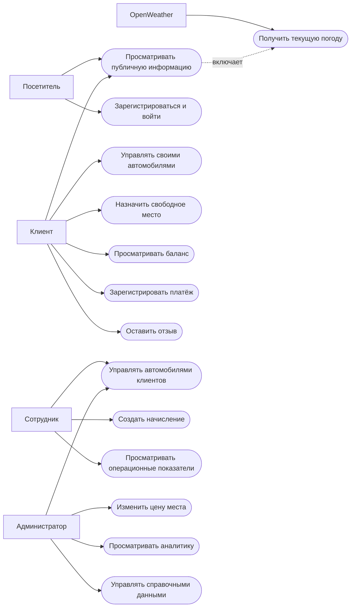

# Спецификация требований SmartParking Solutions

Версия: 1.0  
Дата: 15.10.2026

## 1. Область применения

SmartParking Solutions — веб-система информационного сопровождения парковки. Она хранит сведения о клиентах, автомобилях и парковочных местах, поддерживает финансовый учёт, предоставляет кабинеты пользователей и публикует справочную информацию о компании.

В границы системы входят веб-интерфейс, серверное приложение Django, база данных и файловое хранилище изображений. Погодный сервис, Bootstrap CDN, браузер пользователя и инфраструктура Docker являются внешними компонентами.

## 2. Бизнес-требования

| ID | Требование |
|---|---|
| BR-01 | Система должна централизовать учёт клиентов, автомобилей, парковочных мест, начислений и платежей парковочной компании. |
| BR-02 | Система должна предоставить клиенту самообслуживание: управление своими автомобилями и получение прозрачной информации о начислениях, платежах и текущем балансе. |
| BR-03 | Система должна предоставить сотрудникам и администраторам оперативные и аналитические данные, необходимые для обслуживания парковки и принятия управленческих решений. |

## 3. Актёры

| Актёр | Описание |
|---|---|
| Посетитель | Неаутентифицированный пользователь публичной части сайта |
| Клиент | Зарегистрированный пользователь с ролью `client` |
| Сотрудник | Пользователь с ролью `staff` |
| Администратор | Пользователь с ролью `admin` и правами суперпользователя |
| OpenWeather | Внешний сервис текущей погоды |

## 4. Пользовательские требования

| ID | Пользовательское требование |
|---|---|
| UR-01 | Посетитель должен иметь возможность просматривать публичную информацию о парковке, новости, услуги, промокоды, отзывы, вакансии, контакты и справочник терминов. |
| UR-02 | Посетитель, достигший 18 лет, должен иметь возможность зарегистрироваться и войти в систему. |
| UR-03 | Клиент должен иметь возможность просматривать и управлять только своими автомобилями, включая назначение свободного парковочного места. |
| UR-04 | Клиент должен иметь возможность просматривать начисления, платежи и баланс по своим автомобилям, а также регистрировать платеж. |
| UR-05 | Клиент должен иметь возможность опубликовать отзыв с оценкой от 1 до 5. |
| UR-06 | Сотрудник должен иметь возможность просматривать автомобили и платежи всех клиентов, управлять автомобилями и создавать начисления. |
| UR-07 | Администратор должен иметь возможность просматривать аналитику, фильтровать данные, изменять цену парковочных мест и управлять справочными данными. |

## 5. Use case диаграмма

## 6. Краткие спецификации use case

### UC-01. Регистрация клиента

- Актёр: посетитель.
- Предусловие: пользователь не аутентифицирован.
- Основной поток: открыть форму → ввести имя, email, телефон, дату рождения и пароль → отправить форму → получить перенаправление на вход.
- Альтернативы: возраст меньше 18 лет, дата в будущем, неверный телефон, слабый пароль или занятое имя — форма отображает ошибки, пользователь не создаётся.
- Результат: создан пользователь с ролью клиента.

### UC-02. Управление автомобилем

- Акторы: клиент, сотрудник, администратор.
- Предусловие: пользователь аутентифицирован.
- Основной поток: открыть список → создать или выбрать автомобиль → изменить данные или назначить свободное место → сохранить.
- Альтернативы: дублирующийся госномер, занятое место, недопустимый формат номера или отсутствие прав — операция отклоняется.
- Результат: данные автомобиля сохранены, занятость мест согласована.

### UC-03. Регистрация платежа

- Актёр: клиент.
- Предусловие: клиент аутентифицирован и владеет хотя бы одним автомобилем.
- Основной поток: открыть личный кабинет → выбрать свой автомобиль → указать положительную сумму → подтвердить.
- Альтернатива: неверная сумма или чужой автомобиль — платёж не создаётся.
- Результат: платёж сохранён и учтён при вычислении баланса.

### UC-04. Создание начисления

- Актёр: сотрудник.
- Предусловие: сотрудник аутентифицирован.
- Основной поток: открыть панель сотрудника → выбрать автомобиль → указать сумму, месяц и год → подтвердить.
- Альтернативы: неположительная сумма, недопустимый месяц/год или повторное начисление за тот же период — запись не создаётся.
- Результат: начисление сохранено и показано в кабинетах.

### UC-05. Аналитика администратора

- Актёр: администратор.
- Предусловие: пользователь аутентифицирован как суперпользователь.
- Основной поток: открыть панель → задать период, строку поиска, сортировку или марку → получить показатели и списки → при необходимости изменить цену места.
- Альтернатива: некорректный параметр фильтра — система должна отклонить его и сохранить доступность страницы.
- Результат: отображены показатели задолженности, платежей, клиентов, автомобилей и парковочных мест.

### UC-06. Публикация отзыва

- Актёр: клиент.
- Предусловие: клиент аутентифицирован.
- Основной поток: открыть отзывы → выбрать оценку 1–5 → ввести текст → отправить.
- Альтернатива: пользователь не аутентифицирован или имеет служебную роль — отзыв не создаётся.
- Результат: отзыв связан с клиентом и отображён в общем списке.

## 7. Функциональные требования

| ID | Требование |
|---|---|
| FR-01 | Система должна без аутентификации отображать главную страницу, сведения о компании, новости, термины, контакты, политику конфиденциальности, вакансии, промокоды, отзывы и каталог услуг. |
| FR-02 | Система должна создавать клиента только при корректном имени пользователя, пароле, телефоне формата `+375 (25|29|33|44) XXX-XX-XX` и возрасте не менее 18 лет. |
| FR-03 | После успешной регистрации система должна перенаправлять пользователя на страницу входа. |
| FR-04 | Система должна поддерживать вход и выход средствами Django Authentication и перенаправлять неаутентифицированного пользователя с защищённой страницы на страницу входа. |
| FR-05 | Система должна автоматически согласовывать роль с флагами доступа: клиент — не сотрудник, сотрудник — `is_staff`, администратор — `is_staff` и `is_superuser`. |
| FR-06 | Клиент должен видеть в списке автомобилей только автомобили, среди владельцев которых он указан; сотрудник и администратор должны видеть все автомобили. |
| FR-07 | Аутентифицированный пользователь должен иметь возможность создать автомобиль с маркой, моделью и уникальным госномером. |
| FR-08 | Изменять и удалять автомобиль может его владелец либо пользователь со служебными правами; остальным система должна вернуть отказ в доступе. |
| FR-09 | Госномер автомобиля должен быть уникальным и содержать только заглавные латинские буквы, цифры, дефис и пробел. |
| FR-10 | Номер парковочного места должен быть уникальным целым числом от 1 до 999, а месячная цена — числом больше нуля. |
| FR-11 | В форме автомобиля система должна предлагать только места, не назначенные другим автомобилям. |
| FR-12 | При назначении места автомобилю система должна пометить новое место занятым; при смене, снятии назначения или удалении автомобиля — освободить прежнее место. |
| FR-13 | Сотрудник должен иметь возможность создать начисление с положительной суммой, месяцем 1–12 и допустимым годом. |
| FR-14 | Система не должна допускать два начисления для одного автомобиля за один и тот же месяц и год. |
| FR-15 | Клиент должен иметь возможность зарегистрировать положительный платёж только для автомобиля, которым он владеет. |
| FR-16 | В личном кабинете система должна отображать по каждому автомобилю начисления, платежи и баланс, вычисленный как сумма платежей минус сумма начислений. |
| FR-17 | Панель сотрудника должна отображать начисления, платежи, клиентов, общую сумму платежей и количество свободных и занятых мест. |
| FR-18 | Администратор должен иметь возможность изменить цену парковочного места на положительное значение. |
| FR-19 | Каталог услуг должен поддерживать совместную фильтрацию по категории, минимальной и максимальной цене. |
| FR-20 | При отрицательной, нечисловой или обратной границе цены каталог должен показать сообщение об ошибке и не завершаться ошибкой сервера. |
| FR-21 | Только аутентифицированный клиент без служебных прав должен иметь возможность создать отзыв с непустым текстом и оценкой от 1 до 5. |
| FR-22 | Промокод должен отображаться как активный только при `is_active=True` и текущей дате внутри интервала `valid_from ≤ today ≤ valid_until`; остальные промокоды должны отображаться в архиве и не должны выводиться в каталоге услуг. |
| FR-23 | Главная страница должна запрашивать погоду для Минска и при успешном ответе отображать температуру, описание и рекомендацию. |
| FR-24 | При ошибке или недоступности OpenWeather система должна продолжить отображение главной страницы без погодного блока. |
| FR-25 | Панель администратора должна принимать только допустимые поля сортировки и корректные даты периода; некорректный параметр должен приводить к сообщению об ошибке или безопасному значению по умолчанию, но не к HTTP 500. |

## 8. Нефункциональные требования

| ID | Категория | Требование |
|---|---|---|
| NFR-01 | Безопасность | Все операции с автомобилями, начислениями, платежами и аналитикой должны быть защищены аутентификацией и проверкой роли или владения объектом. |
| NFR-02 | Надёжность | Некорректный пользовательский ввод не должен приводить к необработанному исключению и ответу HTTP 500. |
| NFR-03 | Производительность | При локальном запуске с демонстрационным набором данных каждая публичная страница должна отвечать не более чем за 2 секунды в пяти последовательных запросах. |
| NFR-04 | Отказоустойчивость | Отказ внешнего погодного сервиса не должен делать главную страницу недоступной. |
| NFR-05 | Защита конфигурации | Секретный ключ Django и ключи внешних API должны передаваться через переменные окружения; production-конфигурация не должна использовать `DEBUG=True` и `ALLOWED_HOSTS=['*']`. |
| NFR-06 | Переносимость | Приложение должно запускаться на Python 3.13 локально с SQLite и в Docker Compose с PostgreSQL 15. |
| NFR-07 | Сопровождаемость | Код должен сохранять разделение ответственности Django MVT: данные и бизнес-ограничения размещаются в моделях, обработка ввода — в формах, HTTP-сценарии — в представлениях, отображение — в шаблонах. |
| NFR-08 | Наблюдаемость | Значимые действия и ошибки должны записываться в консоль и файлы `logs/parking.log` и `logs/errors.log` с уровнем и временем события. |

## 9. Ограничения и допущения

- Платёж в текущей версии является внутренней учётной записью; интеграция с банком отсутствует.
- Назначение места не моделирует почасовую парковочную сессию и историю перемещений.
- Интерфейс рассчитан на русскоязычного пользователя.
- Для демонстрационных данных используется город Минск и белорусский формат телефона.
- Внешние изображения Bootstrap и OpenWeather требуют сетевого доступа браузера.
- Требования описывают существующую систему; обнаруженные расхождения зарегистрированы в `ISSUES.md`, но исходный код приложения не изменяется.
