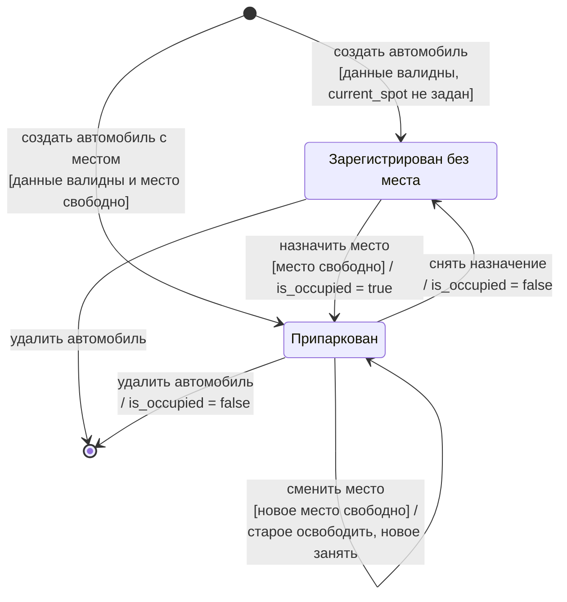
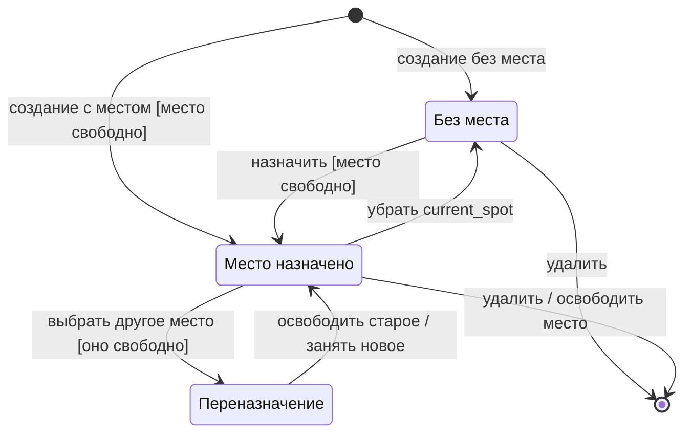

# Диаграмма состояний автомобиля

## Выбранная сущность

Сущность с жизненным циклом — `Car` («Автомобиль»). Её состояние определяется существованием записи и значением связи `current_spot` с парковочным местом.

## Состояния

| Состояние | Условие |
|---|---|
| Не существует | Запись автомобиля ещё не создана либо уже удалена |
| Зарегистрирован без места | Запись существует, `current_spot = null` |
| Припаркован | Запись существует, `current_spot` указывает на свободное при назначении место; у места `is_occupied = true` |

## Диаграмма

Чтобы избежать неоднозначности самоперехода при смене места, его можно представить детальнее:

## Таблица переходов

| Исходное состояние | Событие | Условие | Действие | Новое состояние |
|---|---|---|---|---|
| Не существует | Создание без места | Поля автомобиля валидны, госномер уникален | Сохранить автомобиль, связать владельцев | Зарегистрирован без места |
| Не существует | Создание с местом | Поля валидны, место свободно | Сохранить автомобиль, установить `is_occupied=true` | Припаркован |
| Зарегистрирован без места | Назначение места | Выбранное место свободно | Установить `current_spot`, занять место | Припаркован |
| Припаркован | Смена места | Новое место свободно | Освободить старое место, назначить и занять новое | Припаркован |
| Припаркован | Снятие назначения | Пользователь имеет право редактирования | Очистить `current_spot`, освободить место | Зарегистрирован без места |
| Зарегистрирован без места | Удаление | Пользователь является владельцем либо сотрудником | Удалить запись автомобиля | Конечное состояние |
| Припаркован | Удаление | Пользователь является владельцем либо сотрудником | Освободить место и удалить автомобиль | Конечное состояние |

## Запрещённые переходы

- Назначение места, которое уже связано с другим автомобилем.
- Создание автомобиля с уже существующим госномером.
- Изменение или удаление автомобиля посторонним клиентом.
- Создание автомобиля с госномером, не соответствующим установленному формату.

## Связь с реализацией

- выбор доступных мест формируется в `CarForm.__init__`;
- занятие нового и освобождение старого места выполняется в `Car.save`;
- освобождение места при удалении выполняется в `Car.delete`;
- права на изменение и удаление проверяются в `car_edit` и `car_delete`.
